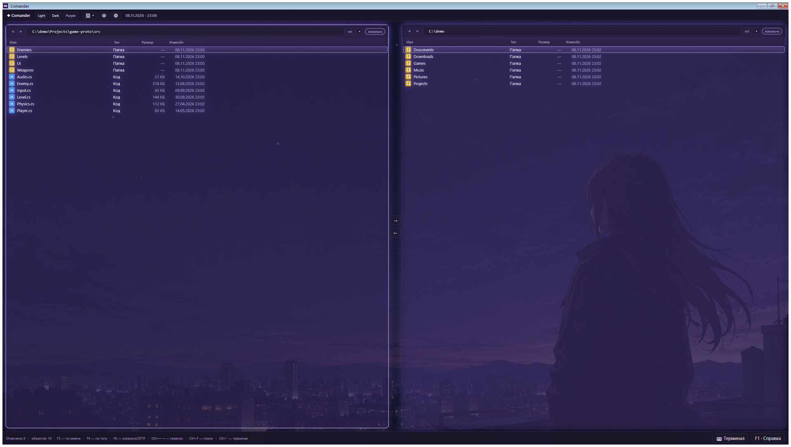

# Comander

Comander — файловый менеджер для Windows. Более удобная и функциональная альтернатива Проводнику: две панели вместо одного окна, все операции на горячих клавишах, встроенный терминал и передача файлов на другие компьютеры.



## Почему удобнее Проводника

- **Две панели рядом** — видишь сразу два каталога и перекидываешь файлы между ними одной кнопкой
- **Всё с клавиатуры** — копировать, перемещать, переименовывать, искать можно, не трогая мышь
- **Терминал внутри** — linux-команды (ls, grep, find) работают прямо в Windows, без отдельных окон
- **Другой компьютер как своя папка** — подключился по SFTP и управляешь файлами Linux-машины как локальными
- **Быстрый доступ** — закрепляешь часто используемые папки и попадаешь в них в один клик

## Системные требования

- Windows 10 / 11 (64-bit)
- Ничего доустанавливать не нужно — всё необходимое уже внутри

## Установка

**Установочный файл: `Comander-1.0.0-setup.exe`**

Запусти его — рядом появится папка `Comander` с программой, и она сразу откроется. Дальше запускай `Comander\Comander.exe` из этой папки (сам файл установки можно удалить).

**Portable-версия: `Comander-1.0.0-portable.zip`**

Распакуй в любую папку (можно на флешку) и запусти `Comander.exe`. Установка не нужна.

> Настройки и профили подключений хранятся отдельно, в `%LOCALAPPDATA%\Comander` — portable-версию можно обновлять простой заменой папки, ничего не потеряется.

## Что умеет

- **Работа с файлами** — копировать, вырезать, вставлять, удалять (в корзину), переименовывать, создавать файлы и папки
- **Две панели** — левая всегда твой компьютер, правая — твой компьютер или удалённая машина; перенос между ними кнопками-стрелками или Ctrl+←/Ctrl+→
- **Отметки** — помечаешь несколько файлов и удаляешь/копируешь их одной командой
- **Поиск** — по имени в текущей папке (F3), по расширению (F4), по всем дискам (Ctrl+F); колонки результатов можно растягивать
- **Быстрый доступ** — в корне списка: Документы, Загрузки, Рабочий стол и твои собственные закреплённые папки
- **Терминал** (Ctrl+`) — выбираешь в настройках: Git Bash (linux-команды), PowerShell или cmd; к удалённой машине тоже можно открыть терминал
- **SFTP** — сохранённые подключения с именами: IP, логин, пароль или SSH-ключ; секреты хранятся в защищённом хранилище Windows
- **Перенос на другой компьютер** — выделил файлы, нажал стрелку, видишь прогресс; можно отменить
- **Темы и оформление** — светлая, тёмная и фиолетовая темы, настраиваемый размер шрифта, фоновые картинки с прозрачностью панелей
- **Автозапуск** — включается в настройках; из любого приложения Comander вызывается сочетанием Ctrl+Alt+C

## Горячие клавиши

| Клавиши | Действие |
| --- | --- |
| W/S или ↑/↓ | Курсор по списку (Shift — выделить диапазон) |
| Q / E | Назад / вперёд по истории папок |
| Backspace | В родительскую папку |
| Пробел или Enter | Открыть |
| Ctrl+Пробел | Отметить файл / папку |
| Esc | Снять все отметки |
| F2 или Ctrl+R | Переименовать |
| Ctrl+N / Ctrl+Shift+N | Новый файл / новая папка |
| F3 | Фильтр по имени |
| F4 | Фильтр по расширению |
| F5 | Обновить папку |
| F6 | Режим панели: локально / SFTP |
| Ctrl+F | Поиск по всем дискам |
| Ctrl+C / Ctrl+X / Ctrl+V | Копировать / вырезать / вставить |
| Ctrl+→ / Ctrl+← | Перенести выделенное в другую панель |
| Ctrl+L | Адресная строка |
| Ctrl+P | Закрепить путь в корне |
| Ctrl+` | Терминал |
| Ctrl+2 | Показать / скрыть вторую панель |
| Ctrl+Tab | Переключение между панелями |
| Ctrl+M | Свернуть окно |
| Ctrl+Alt+C | Вызвать Comander из любого приложения |
| F1 | Полная справка по клавишам |

## Сборка из исходников

```
dotnet publish -c Release -r win-x64 --self-contained true \
  -p:PublishSingleFile=true -p:EnableCompressionInSingleFile=true
```

Исходники: C# / .NET 9 / WPF. Зависимости: SSH.NET.

## Лицензия

MIT — используй свободно.
